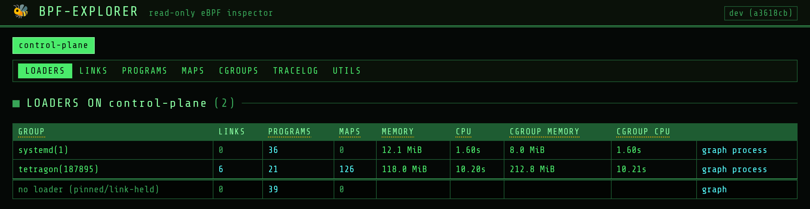
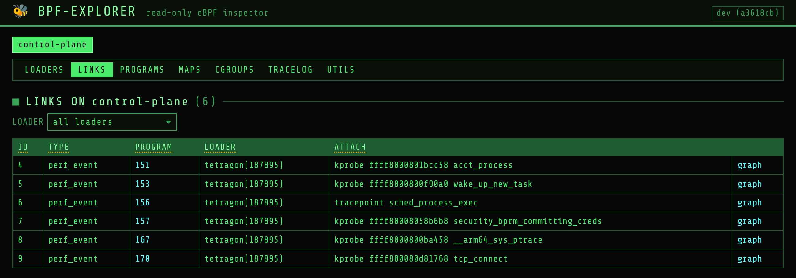
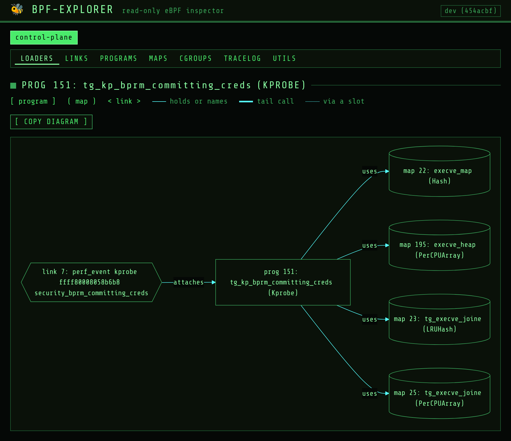
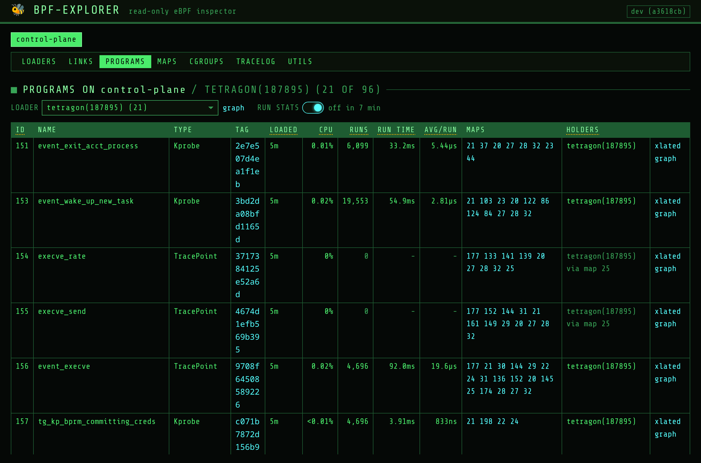
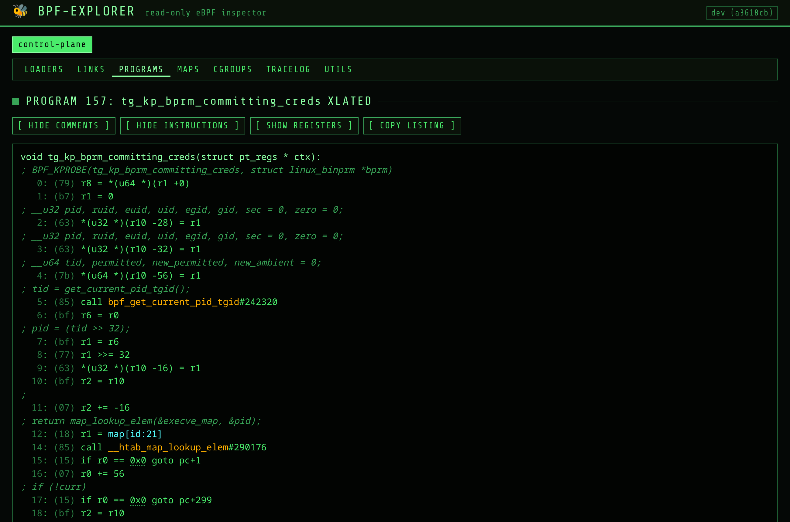
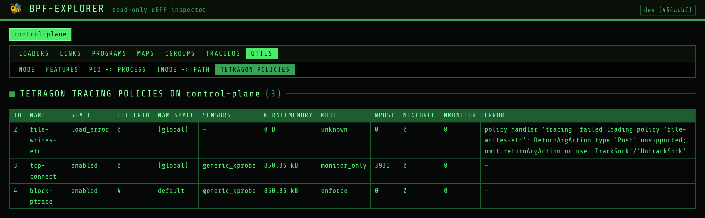
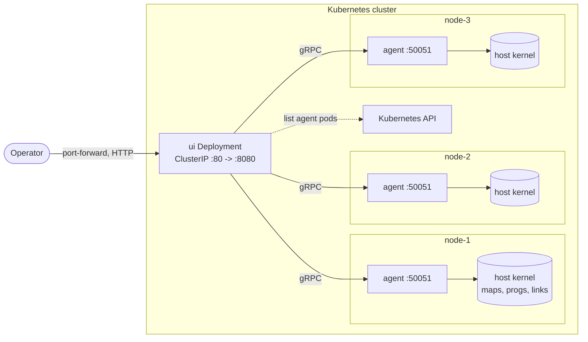

# bpf-explorer

A read-only web UI for browsing eBPF maps and programs. Run it on a single
Linux host, or deploy it to Kubernetes to browse every node from one place -
so you don't have to `kubectl exec` into a per-node
[`bpftool-daemon`](https://github.com/lazybpf/bpftool-daemon) pod to see what's
loaded.

> [!NOTE]
> This is a relatively new project, so there may be some hiccups. If you hit
> one, please [open an issue](https://github.com/lazybpf/bpf-explorer/issues)
> with the build version from the UI header - or `bpf-explorer --version` - e.g.
> `v0.1.0 (0dd5b51)`, plus the output of `uname -r` and `cat /etc/os-release`
> on a single host, or `kubectl get nodes -o wide` on a cluster. Kernel
> version, OS image, and container runtime largely decide which BPF objects are
> inspectable at all.

Each release ships a container image on GHCR for the cluster, and a static
binary plus an install script for a single host, all for `linux/amd64` and
`linux/arm64` - see [Quick start](#quick-start). [Architecture](#architecture)
shows how the pieces fit together.

## What you get

The `loaders` tab lists the processes that loaded links, programs and maps on
a node, with their memory and CPU use:



The `links` tab lists the links on a node, the program each one attaches and
where it is attached:



Each link has a graph of the objects around it in the kernel. Links
attach programs. Programs reference maps. Here Tetragon's link 7 is a
`perf_event` link that attaches the `tg_kp_bprm_committing_creds` kprobe
program, and that program references four maps:



The `programs` tab lists the programs on a node. Turn on run stats to see how
many times each program ran and its average run time. They switch off after 10
minutes:



Every program has an `xlated` tab. It shows the translated bytecode, the same
disassembly as `bpftool prog dump xlated`. Map ids are links; calls to BPF
helpers are highlighted:



These are five views. There are more: maps and their contents, program details,
the trace log for each node, and the `utils` tab. Run the tool to see
them.

If the node runs [Tetragon](https://tetragon.io), `utils` also lists its
tracing policies, with the same columns as `tetra tracingpolicy list` and any
policy errors:



## Quick start

### On a Linux host

Install the latest release to ~/.local/bin:

```console
curl -fsSL https://github.com/lazybpf/bpf-explorer/releases/latest/download/install.sh | bash
```

Run it with sudo - reading BPF objects needs root - and browse
http://localhost:8080, where the host is listed as `local`:

```console
sudo ~/.local/bin/bpf-explorer
```

Ctrl-C stops it; `rm ~/.local/bin/bpf-explorer` removes it.

### On a Kubernetes cluster

Nothing to clone - label the node(s) you want an agent on and apply the manifest
attached to the latest release:

```console
kubectl label node <node> bpf-explorer=true
```

```console
kubectl apply -f https://github.com/lazybpf/bpf-explorer/releases/latest/download/bpf-explorer.yaml
```

Then port-forward the UI and browse http://localhost:8080:

```console
kubectl -n bpf-explorer port-forward svc/bpf-explorer-ui 8080:80
```

Or run it in the background so it does not block your terminal:

```console
nohup kubectl -n bpf-explorer port-forward svc/bpf-explorer-ui 8080:80 > /tmp/bpf-explorer-pf.log 2>&1 &
```

> [!TIP]
> The DaemonSet uses a `nodeSelector` (`bpf-explorer: "true"`) so agents only
> land on labelled nodes. Remove the selector to run on every node.

To clean up, stop the background port-forward if you started one, then delete
the namespace and the label:

```console
pkill -f "port-forward svc/bpf-explorer-ui"
```

```console
kubectl delete namespace bpf-explorer
```

```console
kubectl label node <node> bpf-explorer-
```

## Architecture

bpf-explorer runs as two components:

- agent (`--role=agent`) - gRPC server in a privileged DaemonSet; reads maps and
  programs via [`cilium/ebpf`](https://github.com/cilium/ebpf).
- ui (`--role=ui`) - a Deployment that discovers agents via the Kubernetes API
  and fans out gRPC calls, serving HTML. `ClusterIP` only; reached via
  `kubectl port-forward`.

One binary serves both roles; one image runs both workloads. A third role,
`--role=local`, runs the two together in a single process on one host, no
cluster needed.
It is the default, so a bare `bpf-explorer` runs both halves; the manifest names
`--role` explicitly for the two cluster workloads.

In a three-node cluster with an agent on every node:



## Build

Pure Go - no CGO, and the gRPC stubs in `gen/` are committed, so there is no
codegen step:

```console
go build -o bpf-explorer ./cmd/bpf-explorer
```

Unit tests need no cluster and no privileges:

```console
go test ./...
```

The image. `:dev` is the tag `bpf-explorer.yaml` tracks in this repo, so a local
build drops straight into the manifest:

```console
docker build -t ghcr.io/lazybpf/bpf-explorer:dev .
```

Multi-arch (cross-compiled, no emulation needed):

```console
docker buildx build --platform linux/amd64,linux/arm64 \
  -t ghcr.io/lazybpf/bpf-explorer:dev .
```

## Load into a containerd dev cluster with `ctr`

For a single-node / dev cluster running containerd (k3s, kind's containerd, a
bare kubeadm node), import the image straight into the `k8s.io` namespace so the
kubelet can use it without a registry:

```console
docker save ghcr.io/lazybpf/bpf-explorer:dev -o /tmp/bpf-explorer.tar
sudo ctr -n k8s.io images import /tmp/bpf-explorer.tar && rm /tmp/bpf-explorer.tar
```

Then apply this repo's manifest, which points at `:dev` with
`imagePullPolicy: IfNotPresent`, so the imported image is used as-is:

```console
kubectl apply -f bpf-explorer.yaml
```

## Develop on macOS

There is no eBPF on macOS, so building and running need a Linux machine.
[`.lima/bpf-explorer-dev.yaml`](.lima/bpf-explorer-dev.yaml) is a
[Lima](https://lima-vm.io) template for one, carrying the toolchain, a
single-node Kubernetes cluster, and `bpftool` to check the output against:

```console
limactl start .lima/bpf-explorer-dev.yaml && limactl shell bpf-explorer-dev
```

Your home directory is mounted at the same path in the VM, so the clone you
start from is the one you land in, and every command in this README runs in
there unchanged - Lima forwards the ports, so the UI still opens in a browser
on the Mac. The node is already labelled `bpf-explorer=true`.

## Releasing

Pushing an annotated tag is the only way to publish. Tags are GPG-signed, like
commits, and show as Verified on GitHub; check one with `git tag -v v0.1.0`.
The [`release`](.github/workflows/release.yaml) workflow builds the
multi-arch image, pushes it to GHCR under the tag name, and opens a GitHub
release whose notes come from the tag annotation:

```console
git tag -s v0.1.0 -m "v0.1.0 - first release"
git push origin v0.1.0
```

Each release carries a copy of `bpf-explorer.yaml` with the image line rewritten
from `:dev` to that release's tag, so what a cluster runs is always a version
someone tagged. There is no `:latest` image tag - nothing floats.

Releases also carry linux/amd64 and linux/arm64 binaries for running without a
cluster, e.g. releases/latest/download/bpf-explorer-linux-arm64.tar.gz.

> [!IMPORTANT]
> Tags and releases are immutable. Nothing can be re-published under a version
> that already shipped, so every fix - however small - goes out as a new tag.

Versions are [semantic](https://semver.org): `vMAJOR.MINOR.PATCH`. Bump PATCH
for fixes, MINOR for backwards-compatible additions, MAJOR for a breaking change
to the manifest or the flags. The gRPC surface between the UI and the agents is
internal - both ship in the same image, so it can change without a MAJOR bump.

### Release candidates

A hyphen makes the tag a pre-release, so bake one before a MINOR or MAJOR bump:

```console
git tag -s v0.2.0-rc.1 -m "v0.2.0-rc.1 - cursor pagination for DumpMap"
git push origin v0.2.0-rc.1
```

Candidates are deliberately quieter than releases:

| Tag | Image | GitHub release |
| --- | ----- | -------------- |
| `v0.2.0-rc.1` | `:v0.2.0-rc.1` | marked pre-release |
| `v0.2.0` | `:v0.2.0` | latest release |

Since `releases/latest/download/` resolves to the newest release that is *not* a
pre-release, an `rc` never becomes what the Quick start installs - test it by
applying its manifest explicitly:

```console
kubectl apply -f https://github.com/lazybpf/bpf-explorer/releases/download/v0.2.0-rc.1/bpf-explorer.yaml
```

Iterate with `-rc.2`, `-rc.3`, ... and cut the final `v0.2.0` from the same
commit as the last candidate once it looks good.

## Related projects

- [`ebpfdev/explorer`](https://github.com/ebpfdev/explorer) is the closest thing
  to this tool - a web UI over one Linux host, `docker run` instead of a
  DaemonSet. It looks dormant: nothing committed to any of its three repos since
  June 2023.

  It can do two things this cannot: edit map entries (Hash/Array, including
  per-CPU), and expose map values and per-program run counts to Prometheus. What
  it lacks: more than one node, and any bytecode disassembly - both unchecked
  boxes on its roadmap - plus the trace log and `/proc` lookups.

- [`Trac3X/eMAN`](https://github.com/Trac3X/eMAN) is a Rust TUI for browsing
  eBPF maps and programs on a single local machine, no cluster. Pre-release:
  only the map list/detail views work so far, no install path yet.

## License

Apache License 2.0 - see [LICENSE](LICENSE).
